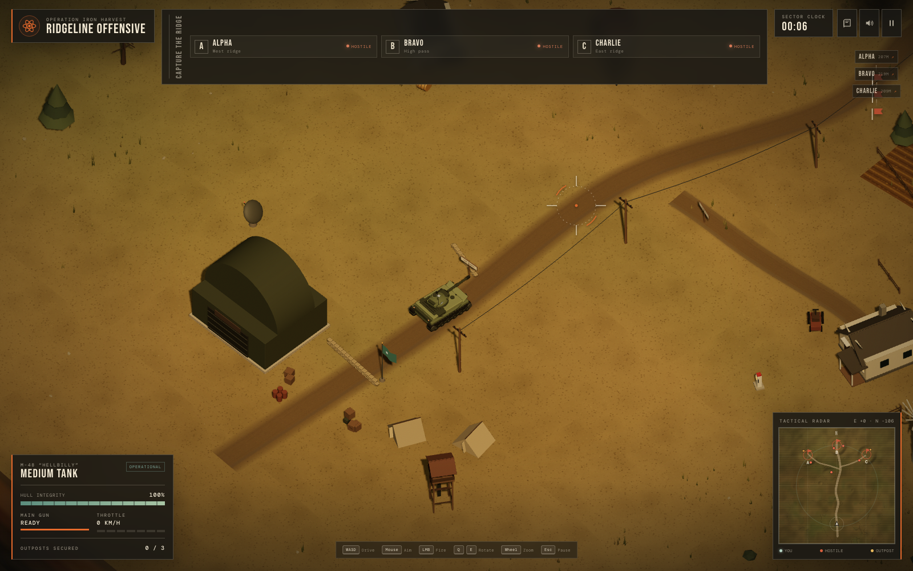
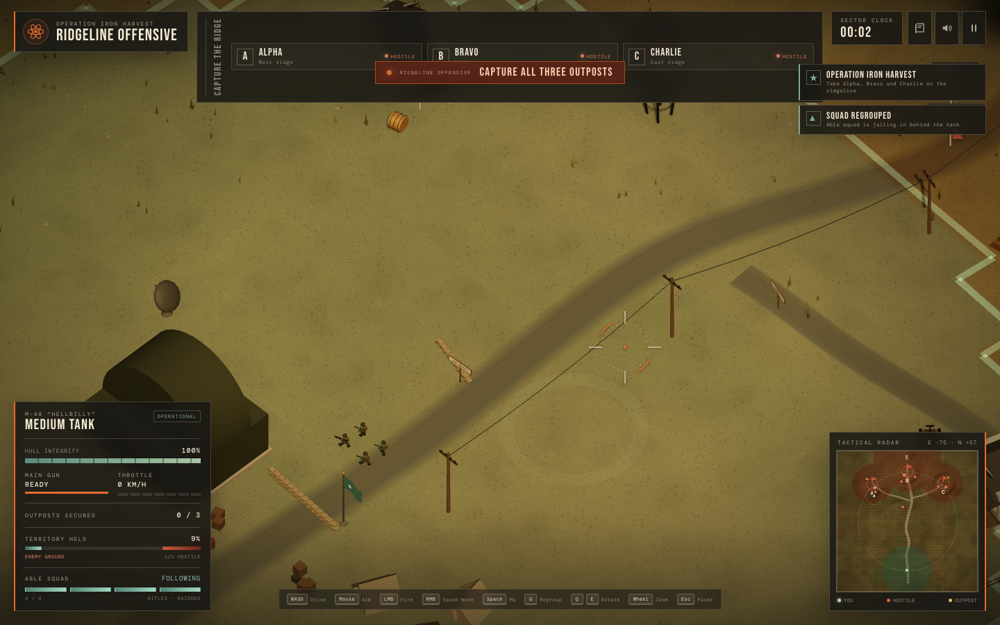
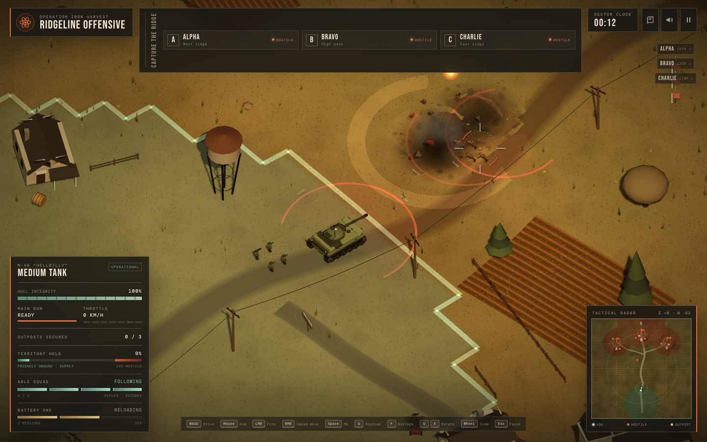

# Tank Country

**Atomic-frontier armored combat on a tabletop diorama.**

Tank Country is a browser game built with three.js. You command an M-48 “Hellbilly”, a rifle squad, and an off-map howitzer battery against the Crimson Corps on a 1:400-scale ridge-and-valley diorama. Capture outposts, hold ground, and keep enemy armor, infantry, artillery, and bombers off the ridge.

The long-term target is an **Empire Earth–style real-time strategy game anchored in the Atomic era (1957)**. The current build is a combined-arms vertical slice: one tank, one rifle squad, one fire-support battery, one map, three outposts, and hostile infantry and armor. Aircraft and the full RTS layer are the next phases.



## Status

| Item | Detail |
|---|---|
| **Current build** | Playable single-player combined-arms slice |
| **Player force** | One medium tank, one four-man rifle squad, one off-map battery |
| **Enemy force** | Light/heavy tanks, rifle squads, towed artillery, bombers |
| **Objective** | Capture Alpha, Bravo, and Charlie |
| **Territory** | Live 80×80 ownership grid with contested borders |
| **Tech** | Vite 7, three.js 0.187, vanilla ES modules |
| **Assets** | Models, textures, audio, and fonts are self-hosted/generated |

> This is not a full RTS yet. There is no base building, unit production, economy, or selection box. Those are roadmap phases, not existing features.

## Play it

Requires Node 20.19+ (Vite 7).

```bash
npm install
npm run dev
```

Open <http://localhost:5173>. Click **Deploy Tank** or press **Enter**.

Production build:

```bash
npm run build
npm run preview
```

## Docker Compose

The repository ships a Compose stack for development, production, and tests.

```bash
# Development server with a bind mount (default service)
docker compose up

# Production image: nginx, non-root, CSP and cache headers
docker compose --profile prod up --build
# -> http://localhost:8080  (override with WEB_PORT=8090)

# Unit + integration tests in a Node container
docker compose --profile test run --rm test

# Playwright end-to-end suite in the Playwright image
docker compose --profile test run --rm e2e
```

Use `--build` after changing `package.json` or the Dockerfiles. The e2e container needs a larger `/dev/shm`; the Compose file sets `shm_size: 1gb`. Coverage reports are written under `coverage/docker/`.

The production image is a two-stage build: Vite compiles the game, then an unprivileged nginx image serves it on port 8080. Security headers include a strict CSP; fonts are self-hosted so the game works offline and under that policy.

## Controls

| Input | Action |
|---|---|
| `W A S D` / arrows | Drive the hull (camera-relative) |
| Mouse | Traverse the turret and aim |
| Left mouse | Fire the main gun |
| Right mouse | Move Able squad to a point |
| `Space` | Fire the coaxial machine gun |
| `G` | Regroup the squad on the tank |
| `F` | Arm a Battery One fire mission, then click a target |
| `Q` / `E` | Rotate the camera |
| Mouse wheel | Zoom in / out |
| `H` | Field manual |
| `M` | Mute / unmute |
| `Esc` | Pause, close the field manual |
| `Enter` | Deploy from the intro screen |

The hull and turret are independent: driving turns the tank, while the turret keeps tracking the pointer. Aim at an aircraft to lock the main gun for an air shot.

## What is in the build

**Armor**
- Ballistic main gun with shell travel time, gravity, recoil, and muzzle effects.
- Coaxial MG with a hitscan cone against infantry and light chip damage against armor.
- Light enemy tanks, heavy tanks, towed artillery, and level bombers.
- Enemy AI with patrol, alert, and combat states; tanks close to range and strafe, artillery fires indirect barrages, bombers make bombing runs.
- Aircraft can be locked and shot down; captured outposts bring flak batteries online.

**Infantry**



- Player rifle squad: three riflemen and one bazooka team.
- Follow, move, and hold orders; right-click to reposition, `G` to regroup.
- Auto-engagement with line-of-sight checks, rifle fire, and anti-tank rockets.
- Rifle squads can hold a capture ring without the tank.
- Enemy squads defend each outpost, and counterattack waves can include infantry.
- Capturing an outpost reinforces the squad and repairs the tank.

**Artillery**



- Off-map Battery One with three fire missions.
- `F` arms a mission; the next click designates the impact area.
- Three high-arc shells arrive in a staggered spread, with danger markers and shell whistles.
- Spotting is required: the tank (80 m) or a living rifleman (55 m) must have line of sight.
- Minimum range prevents shelling your own position.
- Captures resupply one mission and clear the battery cooldown.
- Enemy towed artillery is now a priority barrage target; one good mission can silence a gun.

**Territory**
- 80×80 ownership grid, four-metre cells, driven by base and outpost influence.
- Contested bands where both factions project similar influence.
- Ground tint, glowing ribbon borders, minimap overlay, and HUD share meter.
- Friendly ground speeds main-gun reload by 20%.
- Outpost ownership immediately redraws the territorial map.
- Captured outposts raise a three-man garrison that holds the ring, engages counterattacks, and can spot for Battery One.

**The battlefield**
- Procedural heightfield valley with a fortified ridgeline and three capturable outposts.
- Dirt roads, a village, four destructible barns, fields, telephone lines, and scattered props.
- Capturing an outpost repairs the tank, resupplies the squad and Battery One, raises a garrison, and turns its flak battery against enemy bombers.
- Escalating enemy waves and counterattacks against outposts you have taken.

**Presentation**
- Orthographic tabletop-diorama camera with camera-relative driving.
- DOM HUD: hull integrity, gun reload, throttle, capture progress, squad strength/order, battery missions/cooldown, territory meter, objective markers, tactical minimap, alerts, and toasts.
- Procedural Web Audio: engine, cannon, rifles, MG, explosions, flak, bomber drone, UI cues.
- Intro poster, pause screen, field manual, victory and defeat reports.

## Project layout

```text
.
├── index.html                 Canvas, HUD, intro, pause, help, end screen
├── src/
│   ├── main.js                Game state, input, camera, spawning, capture, win/loss
│   ├── world.js               Heightfield, roads, outposts, barns, props, flak
│   ├── entities.js            PlayerTank, EnemyTank, EnemyArtillery, Bomber,
│   │                          Shell, Bomb, health bars, danger markers
│   ├── infantry.js            InfantrySquad: orders, targeting, rifles, bazookas
│   ├── artillery.js           Pure barrage plans, spotting and mission validation
│   ├── battery.js             Battery One: ammo, cooldown, queue, high-arc fire
│   ├── models.js              Procedural tank, infantry, artillery, bomber geometry
│   ├── combat.js              Ballistic solver, ray tests, LOS, splash, capture rates
│   ├── capture.js             Pure capture-progress step
│   ├── territory.js           Territory rendering: tint, borders, minimap
│   ├── territory-core.js      Pure ownership grid and influence model
│   ├── effects.js             Particles, explosions, smoke, tracers, decals
│   ├── audio.js               Synthesized Web Audio sound effects
│   ├── hud.js                 HUD, minimap, markers, end screens
│   ├── utils.js               Math, RNG, geometry merging, texture helpers
│   └── style.css              HUD, intro poster, overlays, responsive layout
├── tests/
│   ├── unit/                  Pure logic (Vitest)
│   ├── integration/           Infantry squads and Battery One with fakes (Vitest)
│   └── e2e/                   Browser flows and coverage (Playwright)
├── deploy/nginx.conf          Production static server and security headers
├── Dockerfile                 Dev, test, build and production stages
├── Dockerfile.e2e             Playwright test image
├── docker-compose.yml         dev, web, test and e2e services
└── docs/screenshot.png        README image
```

All gameplay code is plain JavaScript modules. There is no UI framework and no asset pipeline.

## Tests and coverage

The suite has three arms, and **each arm enforces a 90% minimum** over the code that arm is responsible for. Rendering, world generation, HUD and DOM code are exercised by the browser flows but are not line-gated: procedural geometry and visual effects would distort a line-coverage number without proving correctness.

| Arm | Tool | Coverage scope | Gate |
|---|---|---|---|
| **Unit** | Vitest + v8 | `src/combat.js`, `src/capture.js`, `src/territory-core.js`, `src/artillery.js` | 90% statements, branches, functions, lines |
| **Integration** | Vitest + v8 | `src/infantry.js`, `src/battery.js` | 90% statements, branches, functions, lines |
| **End-to-end** | Playwright + Istanbul/NYC | `src/combat.js`, `src/capture.js`, `src/territory-core.js`, `src/infantry.js`, `src/artillery.js`, `src/battery.js` | 90% statements, branches, functions, lines |

```bash
npm test                 # unit + integration + e2e, all coverage gates
npm run test:unit        # 62 tests, 100% of the unit scope
npm run test:integration # 60 tests, 100% lines of the infantry + battery scope
npm run test:e2e         # 19 browser scenarios + core-module coverage
npm run test:e2e:headed  # watch the browser suite
```

Playwright uses the local Chrome-for-Testing binary when it exists; otherwise run `npx playwright install chromium` or set `PLAYWRIGHT_CHROMIUM_PATH`. The Docker e2e image already contains the matching browser.

The e2e arm runs against a coverage-instrumented Vite server on port 5174, collects `window.__coverage__` per scenario, merges it with NYC, and enforces the gate. It covers deploy/aim/camera regressions, squad orders, MG fire, rifle and bazooka combat, artillery targeting and shell impacts, tank-only and infantry-only captures, contested rings, reinforcement, and the pure gameplay core in Chromium.

The older `test-*.mjs` files are manual probes kept for reference; the maintained suites live under `tests/`.

## Design notes

- **Diorama first.** The orthographic camera and 1:400 scale are the identity of the game. Units should read as silhouettes from above, not as realistic models.
- **Combined arms, not tank-only.** Infantry answers armor in cover; armor and artillery answer infantry; aircraft answer static positions. Every arm needs a cheap counter.
- **Territory is a system, not a texture.** Ownership is computed from real influence sources, then rendered as tint, borders, minimap and HUD. Capturing an outpost changes the ground you fight on.
- **Everything is procedural.** Terrain, vehicles, textures, and audio are generated from code. The world layout and textures use fixed seeds; combat uses runtime randomness. The only binary assets are five self-hosted UI font files.
- **Small, readable systems.** Pure rules live in `combat.js`, `capture.js`, `territory-core.js`, and `artillery.js`; scene-bound systems like `battery.js` and `infantry.js` sit beside them. New units should follow the same split so they can be tested without a browser.

## Roadmap

### Phase 1 — Infantry (vertical slice complete)

- [x] Rifle squads and anti-tank teams.
- [x] Squad move/hold/follow orders and auto-engagement.
- [x] Infantry capture participation and reinforcement.
- [ ] Machine-gun teams, engineers, and mortars.
- [ ] Cover, suppression, garrisoning, and transports.
- [ ] Squad selection and multi-squad command.

### Phase 2 — Artillery (fire-support slice complete)

- [x] Off-map Battery One with three missions and a cooldown.
- [x] Indirect fire with spotting, minimum range, flight time, and a staggered barrage pattern.
- [x] HUD ammo/cooldown, danger markers, shell whistles, craters.
- [x] Capture resupply, so territory directly feeds fire support.
- [ ] On-map howitzers and self-propelled guns with crews and transport.
- [ ] Counter-battery fire and “shoot and scoot” behavior.
- [ ] Smoke, illumination, and ammunition types.

### Phase 3 — Aircraft

- Player air wing: fighters, fighter-bombers, and level bombers.
- Air superiority, interception, and strike missions.
- Anti-aircraft guns and flak (the captured-outpost flak is the starting point).
- Rework the existing bomber AI into a reusable aircraft base class.

### Phase 4 — The RTS layer

- Selection box, group commands, and formation movement.
- Resource and supply economy; production queues and reinforcements.
- Base construction and defensive structures.
- Epoch progression with the Atomic era as the anchor; later epochs only after the core loop works.
- Fog of war, scouting, and an AI commander that contests the ridge.
- Save/load and scenario definitions.

### Always

- Counter-play: every unit needs a cheap answer.
- Readable silhouettes and HUD-safe markers.
- Destructible terrain that changes the fight, not just the scenery.
- A stable 60 fps target on integrated GPUs.
- Tests that prove the rule, not just the render.

## Known limitations

- Single player, one map, no save/load.
- One player squad type; no cover, suppression, or multi-squad selection yet.
- Battery One is off-map and cannot be attacked; there is no counter-battery duel yet.
- No player aircraft or on-map self-propelled artillery yet.
- Desktop mouse and keyboard only; no touch controls.
- Balance is early; enemy waves, squad damage, and capture timers are tuned for this slice.
- The production bundle is a single ~763 kB chunk (three.js included).

## Credits

Built with [three.js](https://threejs.org/) and [Vite](https://vite.dev/). UI typefaces are self-hosted: Bebas Neue and DM Mono under the SIL Open Font License, Special Elite under the Apache License 2.0. License texts are in `public/fonts/`.

License: MIT, as declared in `LICENSE` and `package.json`.
